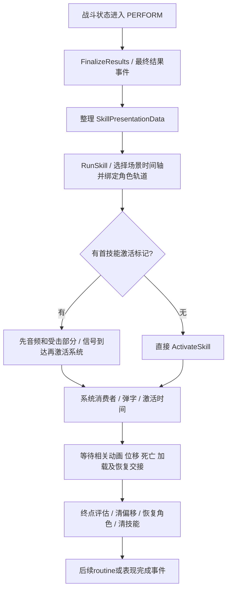

# 《暗黑地牢2》托管程序集研究 · 2026-10-26

## 输入、工具和证据强度

输入为用户新增的 `study/Managed/`。所有DLL只读，不加载进游戏执行。独立SHA256清单：`managed-manifest-2026-10-26.csv`，保留原 `study-manifest.csv` 不变。审计工具比较两份清单的并集，仍会拒绝未登记新增、删除或改写。

本批164文件；原9662文件加本批共9826项审计一致。IronCrown类索引4132条（含嵌套类），不代表逐一研究了4132个类。

工具：本机.NET SDK8.0.403；ILSpy命令行9.1.0.7988安装在忽略目录 `research_sandbox/tools/`。输出在 `research_sandbox/dd2/`，不提交反编译源文件、IL、DLL和工具。工具版本固定用于复现，不声称它是最新版。

| 程序集 | 大小/身份 | 本轮实际用途 |
|---|---|---|
| IronCrown.dll | 5,898,752字节；AssemblyVersion 0.0.0.0 | 核心战斗、表现、角色、弹字、Timeline；主要证据 |
| Assembly-CSharp.dll | 27,136字节；AssemblyVersion 0.0.0.0 | CombatVirtualCameraMgr及渲染辅助；不是主要战斗实现 |
| Cinemachine.dll | 311,808字节；AssemblyVersion 0.0.0.0 | TargetGroup权重/半径/观察空间包围盒；不能据程序集版本推断包发行版 |
| Unity.Timeline.dll | AssemblyVersion 1.0.0.0 | 作为依赖解析，未深入反编译其调度内部 |
| Unity动画/Director/Core、FMOD等 | 依赖在同一Managed目录 | 支持符号解析；未研究所有模块，不把引用关系当完整功能验证 |

**C**＝成功C#反编译的方法实现；**IL**＝直接读取中间语言调用和分支；**I**＝据此提出的本项目适配推断；**U**＝未验证。没有运行原版、没有原版场景、Prefab、Animator Controller、动画片段、Timeline资产和序列化镜头参数；不能还原完整视觉效果或具体每个技能的帧数。

整库 `-p` 反编译IronCrown发生Stack overflow，产物是不完整中间结果，**不作为整库已成功的证据**。增加referencepath后采用逐类型分析，核心表现类型成功。PopTextManager、BattleStateMachine、SkillCalculation的C#转换仍栈溢出，改用IL。IL模式实际输出整个IronCrown（约64MB），再按方法末尾标识截取；文件名PopTextManager.il不代表只包含该类型。Assembly-CSharp整库成功。可疑反编译表达式（例如HoldPresentationStateForPlayableDirectorBhv的getter）未据此推断原作缺陷。

复现示例（在工作区根运行，所有输出都在study外）：

```powershell
dotnet tool install ilspycmd --version 9.1.0.7988 --tool-path ./research_sandbox/tools
./research_sandbox/tools/ilspycmd.exe -l c study/Managed/IronCrown.dll > research_sandbox/dd2/types.txt
./research_sandbox/tools/ilspycmd.exe -t Assets.Code.Combat.Presentation.CombatPresentationBhv -r study/Managed study/Managed/IronCrown.dll > research_sandbox/dd2/CombatPresentationBhv.cs
./research_sandbox/tools/ilspycmd.exe -il -r study/Managed study/Managed/IronCrown.dll > research_sandbox/dd2/IronCrown.il
```

首次使用先创建research_sandbox/dd2；已安装工具无需重复安装。C#产物末尾可能包含工具更新提示，作为阅读产物而非可编译原源码。

## 方法级证据索引

下列文件均相对于 `research_sandbox/dd2/`；行号对应本次固定工具输出，程序集全名、方法名和IL偏移比行号更稳定。正文仅独立描述机制，不移植参考代码。

| ID | 文件/方法位置 | 已验证结论 |
|---|---|---|
| D01 | CombatPresentationBhv.cs:532 HandleSkillFinalizeResults；SkillPresentationData.cs:43–98 | C：把最终结果按技能/表现索引整理进攻击者、目标、额外目标及结果集合 |
| D02 | CombatPresentationBhv.cs:689 Update、2517 AddRoutine、2535 RunNextRoutine；CombatPresentationRoutine.cs | C：routine包含优先级、枚举器、UI/暂停限制；队列按优先级降序排序，协程结束取下一项，空队列发送完成事件 |
| D03 | CombatPresentationBhv.cs:1729 RunSkill，尤其1861–1884、2557 OnNotify | C：有首技能激活标记时，先启用音频/受击部分，标记通知再激活系统；没有标记时直接激活全部。不能简单说“所有受击与声音都等到同一个marker” |
| D04 | CombatPresentationBhv.cs:1194 ActivateSkill、1269–1344、1402–1413 | C：选项区分系统/音频/受击；按友方、命中、守护、反击、miss等选受击触发；激活系统并发布技能表现事件，记录ActivationTime |
| D05 | CombatActorBhv.cs:1762 StartHitReaction、1781 FinishHitReaction、1791 ResetHitReaction | C：已有反应时不重复开启；保存触发器，结束触发hit_recovery并清除旧反应 |
| D06 | CombatPresentationBhv.cs:1682 OnSkillEnded、1926–2030 RunSkill末段、2595 OnSkillRecovery、2641 SetSkillRecoverySequence | C：等待Timeline、加载、死亡和阵位变化；结束时Evaluate终点、Stop、重置参与者、禁用镜头偏移、恢复受击、清理技能；收势允许交接到下一routine，并非全部死等单一固定时长 |
| D07 | CombatPresentationBhv.cs:2132–2174 WaitForPopText/WaitForActorUpdates | C：存在按kill/move/status/poptext选择的屏障及最大等待字段；不能宣称全部协程都有统一超时 |
| D08 | CombatCameraBhv.cs:133–170、204、298–380 | C：条件相机、CameraState混合、技能开始重置、相机变更加入表现routine，部分路径等待blend完成 |
| D09 | CameraZoomInTargetGroup.cs:47–94；CinemachineTargetGroup.cs:145、210、254、322 | C：演员加入/移出特写时调整目标组；成员带权重和半径，计算观察空间包围盒。DLL证明算法存在，不能证明每个技能实际使用哪种Composer |
| D10 | SkillCameraOffsetBhv.cs:SetOffsetByActors | C：按目标数量、角色Large/Short、攻击者体型和多格大小选择偏移/间距；具体数值依赖缺失序列化资产 |
| D11 | CombatTimelineUtils.cs:BindControlTrack/TrySetReferenceValue | C：区分主攻击、反击、ActOut轨道，运行时绑定角色和暴露引用；不是每个技能硬编码一个场景 |
| D12 | CharacterOffsetMixer.cs:OnGraphStart/ProcessFrame/OnGraphStop；CameraShakePlayable.cs:PrepareFrame/OnBehaviourPause/OnGraphStop | C：位移按轨道权重及局部时间评估；以拥有者注册偏移，停图时移除；震动解绑旧相机、暂停/停图清理监听者 |
| D13 | PopTextManager_OnSkillActivated.il，RVA0xd39d0，IL_00be–00c5；PopTextInstanceBhv.cs:102–192 | IL/C：激活消费SkillResults并整理队列；弹字可跟踪角色骨骼、按相机附加偏移缩放，回收清引用。尚未证明其全屏边缘clamp策略 |
| D14 | BattleStateMachine_OnEnterState.il:82–116（IL_00a3–00ff）；SkillCalculation_FinalizeResults.il末段IL_0292；SkillCalculation_ApplyResults.il | IL：IN_TURN_PERFORM调用FinalizeResults并发布结果事件，IN_TURN_APPLY调用ApplyResults；结算与展示不是“一个动画事件里同时计算全部伤害” |
| D15 | Assembly-CSharp/CombatVirtualCameraMgr.cs:Awake/OnGameModeEnterStart | C：旅馆模式禁用虚拟镜头，进入战斗重新启用；仅凭类名误认它为攻击导演会得到错误架构 |

## 一次完整攻击的已确认链条



这是上述方法路径的归纳，不是原版实机时间轴，也不代表所有技能都走同样分支。BattleStateMachine还分CALCULATE/PERFORM/APPLY；当前证据不足以将所有状态跳转和每个Timeline资产的marker精确对齐，不能据此建议本项目改为动画回调修改规则HP。

## 可以借鉴与不应照搬

借鉴：行动拥有其临时效果；显式语义节点；区分受击开始/恢复；按事件屏障结束；按角色实际体型构图；相机和弹字共同使用锚点；死亡与移动是可等待的独立反馈。

不照搬：Unity/Cinemachine依赖、原作类树、数千行CombatPresentationBhv、优先级系统全部细节、Prefab/Timeline业务配置、回合状态机、伤害公式。Godot现有确定性规则与单镜头导演已适用，独立实现最小所需机制即可。

## 未验证结论

1. 原版每个技能的具体时长、hit-stop、摄影曲线、音效起点和实际屏幕构图：缺少资产及原版运行观察。
2. 原版全局暂停对每个Tween/Animator/Timeline/音频的完整覆盖：只确认部分代码，不能称其绝无暂停问题。
3. PopTextManager的完整C#、具体文字防裁切与重叠规则：只验证选定IL方法及实例组件。
4. 条件相机所有组合、目标组所配Composer、巨大角色的最终镜头数值：不能从序列化字段默认值反推真实资产值。
5. 某些反编译生成表达式是否等同原始作者源码：需要IL或运行交叉验证；未用于改造建议。
6. 原版游戏版本、Cinemachine包版本：程序集0.0.0.0不足以确认；SHA256才是此次研究输入身份。
